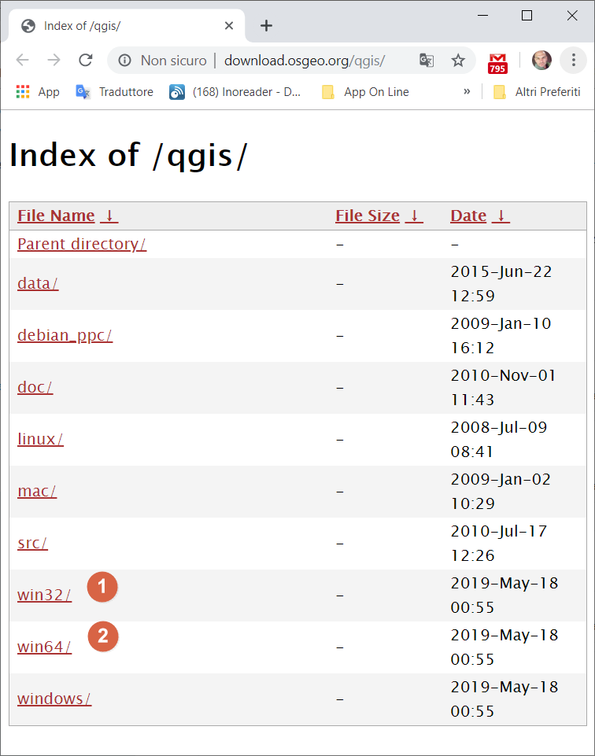
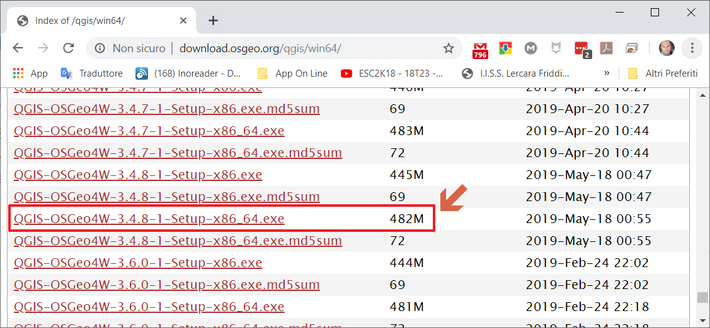
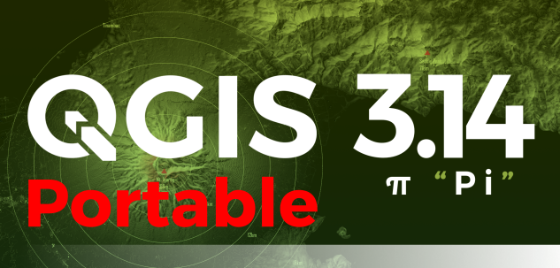
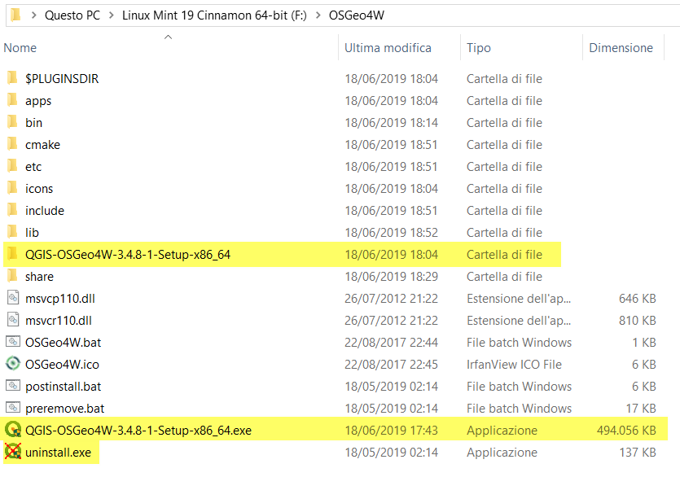
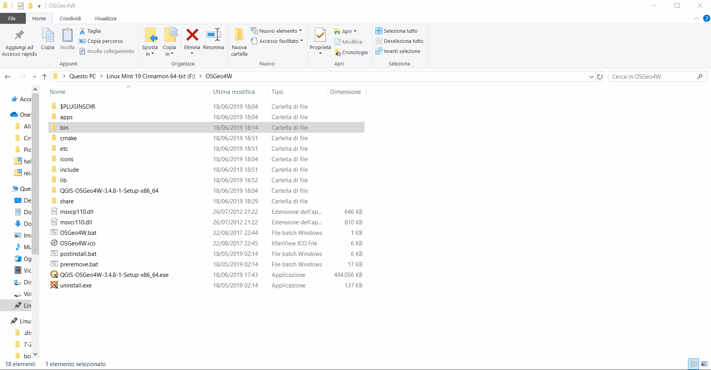
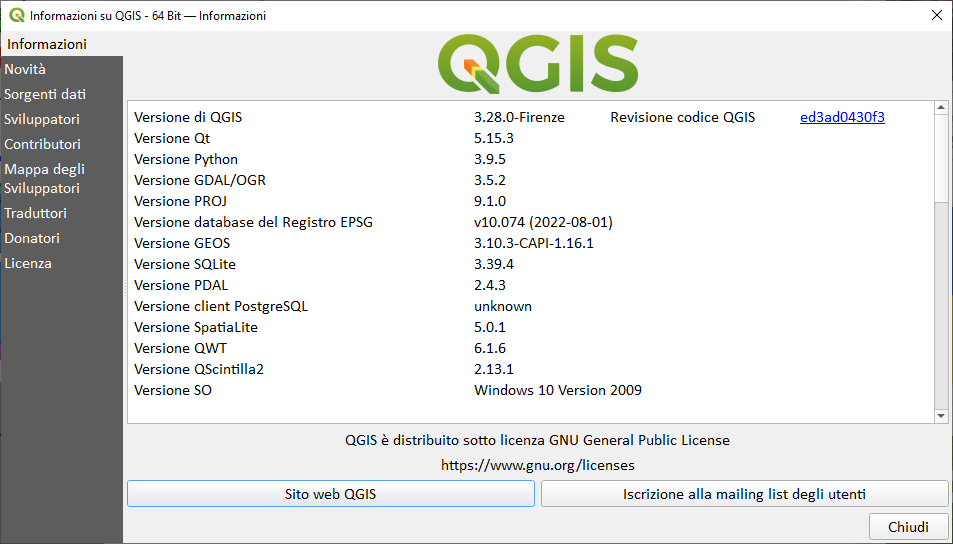
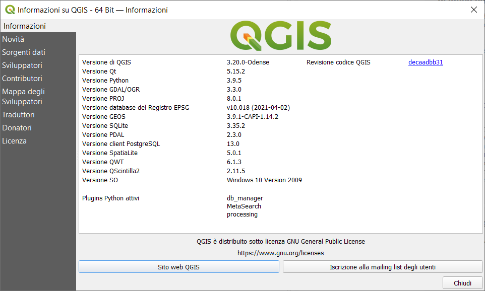
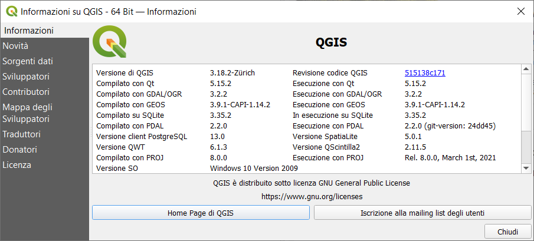

# QGIS Portable 3.x

> **Requisiti:** Windows 10/11 64-bit (per le versioni recenti). Alcune versioni supportano anche Windows 7 64-bit — vedi legenda.

Creare una versione **Portable di QGIS 3.x** usando il file `*.exe` o `*.msi` scaricato dal sito [download.osgeo.org/qgis](http://download.osgeo.org/qgis/).

---

## Note importanti

> **NOTA:** A partire da QGIS 3.24 Tisler, gli eseguibili sono **solo in formato `*.msi`** e pesano circa 3 volte le vecchie `*.exe` perché contengono molti dati aggiuntivi.

> **NOTA:** Il Plugin core **Geometry Checker** ha due [bug segnalati](https://lists.osgeo.org/pipermail/qgis-it-user/2023-April/010258.html), risolti a partire da QGIS 3.28.6 e QGIS 3.30.2.

---

## Indice

- [QGIS Portable 3.x](#qgis-portable-3x)
  - [Note importanti](#note-importanti)
  - [Indice](#indice)
  - [Perché questo repository](#perché-questo-repository)
  - [Che cosa è una versione Portable](#che-cosa-è-una-versione-portable)
  - [Step by step — metodo manuale](#step-by-step--metodo-manuale)
  - [Step by step — usando script Bash](#step-by-step--usando-script-bash)
  - [Connessione al Web e i Plugin](#connessione-al-web-e-i-plugin)
  - [Download versioni Portable (7z)](#download-versioni-portable-7z)
    - [Legenda](#legenda)
    - [OSGeo4W64 v2 — Nuovo Repository](#osgeo4w64-v2--nuovo-repository)
      - [QGIS (versioni correnti)](#qgis-versioni-correnti)
      - [QGIS LTR](#qgis-ltr)
    - [OSGeo4W64 v1 — Vecchio Repository](#osgeo4w64-v1--vecchio-repository)
      - [Con GRASS GIS 7.8](#con-grass-gis-78)
      - [GRASS GIS non abilitato](#grass-gis-non-abilitato)
  - [Riferimenti](#riferimenti)
  - [Disclaimer](#disclaimer)

---

## Perché questo repository

Per tenere traccia di come realizzare una **versione Portable di QGIS 3.x** senza necessariamente aver installato il software.

---

## Che cosa è una versione Portable

Per applicazione portabile (o *portable application*) si intende un software che non necessita di installazione nel sistema operativo su cui viene eseguito. Programmi di questo tipo possono essere memorizzati su supporto rimovibile come cd-rom o memorie flash.

Un'applicazione portabile può essere eseguita su qualsiasi computer con un sistema operativo compatibile. I vantaggi principali sono:
- utilizzare la stessa applicazione su macchine diverse mantenendo le impostazioni personalizzate;
- non richiedendo installazione, spesso può essere eseguita anche senza diritti di amministratore.

[Fonte: Wikipedia — Applicazione portabile](https://it.wikipedia.org/wiki/Applicazione_portabile)

---

## Step by step — metodo manuale

1. Inserire una **pen drive** nel PC (es. unità `F:`);
2. Creare la cartella **OSGeo4W**;
3. Scaricare la versione di **QGIS** desiderata (64 bit):

<p align="center">
  <a href="http://download.osgeo.org/qgis/" target="_blank">
    
  </a>
</p>

   Esempio: `QGIS-OSGeo4W-3.4.8-1-Setup-x86_64.exe`

<p align="center">
  <a href="http://download.osgeo.org/qgis/" target="_blank">
    
  </a>
</p>

4. Estrarre il file `*.exe` e spostare tutta la cartella `QGIS-OSGeo4W-3.4.8-1-Setup-x86_64` dentro `F:\OSGeo4W\`;
5. Spostare tutto il contenuto di `F:\OSGeo4W\OSGeo4W-3.4.1-1-Setup-x86_64\$_25_\` nella cartella `F:\OSGeo4W\`;
6. Trovare il file `F:\OSGeo4W\bin\qgis-ltr.bat.tmpl` (o `qgis.bat.tmpl` per versioni non LTR), copiarlo e rinominarlo in `qgis-ltr.bat`;
7. Copiare i file `msvcp100.dll` e `msvcr100.dll` da `C:\Windows\SysWOW64` (o `System32`) nella cartella `F:\OSGeo4W\apps\qgis\bin\`;
8. Avviare `F:\OSGeo4W\bin\qgis-ltr.bat` — QGIS si avvierà!

<p align="center">
  
</p>

Contenuto della pen drive (le voci evidenziate non sono più necessarie):

<p align="center">
  
</p>

<p align="center">
  
</p>

---

## Step by step — usando script Bash

1. Creare una cartella sul desktop (es. `zanzibar`);
2. Scaricare il file [script.sh](./script.sh) nella cartella appena creata;
3. Aprire `Bash`, entrare nella cartella e digitare:
   ```bash
   chmod +x ./script.sh
   ./script.sh
   ```
4. Dopo circa **30 minuti** verrà creata una cartella zippata `OSGeo4W_349` con la versione portable di QGIS;
5. Estrarre `OSGeo4W_349.7z` dove desiderato e avviare `qgis-ltr.bat` dalla cartella `OSGeo4W\bin`.

> **PS:** Lo script scarica `QGIS-OSGeo4W-3.4.9-1-Setup-x86_64.exe` e i file `msvcp100.dll` / `msvcr100.dll` in versione 64-bit.

---

## Connessione al Web e i Plugin

La versione **portable** si connette alla rete senza problemi.

Per quanto riguarda i **plugin**: è possibile installarli, ma la cartella di configurazione verrà creata nel profilo utente locale:
```
C:\Users\<nomeUtente>\AppData\Roaming\QGIS\QGIS3\profiles\default
```

---

## Download versioni Portable (7z)

### Legenda

| Simbolo | Significato |
|---------|-------------|
| 🙊 | Non funziona su Windows 7 ([issue](https://github.com/qgis/QGIS/issues/56604)) |
| ⭐⭐⭐ | EOL — ultimo rilascio della serie |
| ⭐⭐ | Per Windows 7: rinominare `api-ms-win-core-path-l1-1-0.dll.w7` → `api-ms-win-core-path-l1-1-0.dll` (nella cartella `bin`) ([istruzioni](https://www.facebook.com/pigreco314/posts/pfbid02FAXfkezQXAU65SNzoX2Jq1nrn2jMeCz7w5jDktXbxG8in1ScJhCjL9x4aZsQ3yjml)) |
| ⭐ | Utilizzabile anche su Windows 7 64-bit |
| 💻 | Richiede Windows 11 |

> **Istruzioni generali:** Estrarre il file `.7z` dove desiderato (es. `F:\OSGeo4W64-x.xx.x`) e avviare con doppio clic su `qgis-grass.bat`.

---

### OSGeo4W64 v2 — Nuovo Repository

Con GRASS GIS 7.8+, SAGA GIS 7.8.2, SpatiaLite 5, PDAL 2.2 — solo per **Windows 10/11 64-bit**.

<p align="center">
  
</p>

---

#### QGIS (versioni correnti)

**Con GRASS 7.8.7** (SAGA GIS non è più incluso nel core da QGIS >= 3.30 — vedi plugin [Processing Saga NextGen Provider](https://plugins.qgis.org/plugins/processing_saga_nextgen/))

| Versione | Download | Cartella estrazione |
|----------|----------|---------------------|
| ⭐⭐ QGIS 3.30.2-1 s-Hertogenbosch | [Download](https://drive.google.com/file/d/10ZyKBlIYqnHjSAxOxEbuoQdEP-8fU9Fc/view?usp=sharing) | `OSGeo4W64-3.28.0-2` |
| ⭐⭐ QGIS 3.30.1-1 s-Hertogenbosch | [Download](https://drive.google.com/file/d/10YPBlnUX1gMES7BD7H3PIjhTVLj7T1KZ/view?usp=sharing) | `OSGeo4W64-3.28.0-2` |
| ⭐⭐ QGIS 3.30.0-2 s-Hertogenbosch | [Download](https://drive.google.com/file/d/10O7QwyQDNTRSUqYoFsi0IzHTsowACVP1/view?usp=sharing) | `OSGeo4W64-3.28.0-2` |

**Con GRASS 7.8.7 e SAGA 7.8.2**

| Versione | Download | Cartella estrazione |
|----------|----------|---------------------|
| ⭐⭐ QGIS 3.28.3-1 Firenze | [Download](https://drive.google.com/file/d/1034lGd09ZUnw1yHKsYmQyMMSC0G7G3nv/view?usp=sharing) | `OSGeo4W64-3.28.0-2` |
| ⭐⭐ QGIS 3.28.2-1 Firenze | [Download](https://drive.google.com/file/d/10-RPw5Q6IKVM8kner5jhV5x-XOXgLI9q/view?usp=sharing) | `OSGeo4W64-3.28.0-2` |
| ⭐⭐ QGIS 3.28.1-1 Firenze | [Download](https://drive.google.com/file/d/1-vWfIvJfiOYtzKcbJGaG1-6UiVBVKzj8/view?usp=sharing) | `OSGeo4W64-3.28.0-2` |
| QGIS 3.28.0-2 RC Firenze | [Download](https://drive.google.com/file/d/1-t9mXTkRhDuM40lp5rInsU04JC42EfvT/view?usp=sharing) | `OSGeo4W64-3.28.0-2` |
| QGIS 3.26.3-1 EOL Buenos Aires | [Download](https://drive.google.com/file/d/1-rNpl5dpU7KS3oP_qBo9Iqne1e_RZwdk/view?usp=sharing) | `OSGeo4W64-3.26.3-1` |

---

#### QGIS LTR

**Con GRASS 8.4**

| Versione | Download | Cartella estrazione | Info versione |
|----------|----------|---------------------|----------------|
| 🙊 QGIS 3.44.13-1 Solothurn | [Download](https://drive.google.com/file/d/1U_ogjbnqG9CO_HthzaJaCTI_-6MSXtFG/view?usp=sharing) | `OSGeo4W64-3.44.13-1` | |
| 🙊 QGIS 3.44.8-1 Solothurn | [Download](https://drive.google.com/file/d/1IfnGgCOnZEr0kvNQdFZ1pABVXyOPQaqw/view?usp=drive_link) | `OSGeo4W64-3.44.8-1` |[Info](./info_versioni/QGIS_3448.md) |
| 🙊 QGIS 3.40.15-1 Bratislava | [Download](https://drive.google.com/file/d/1w77oWg7KU2l1nmf7PJms2vdHVcITndqg/view?usp=drive_link) | `OSGeo4W64-3.40.12-1` | [Info](./info_versioni/QGIS_34015.md) |
| 🙊 QGIS 3.40.12-1 Bratislava | [Download](https://drive.google.com/file/d/1YFFceV4WL-JMK3RzLuI_yAAk-j4CkUrE/view?usp=drive_link) | `OSGeo4W64-3.40.12-1` | |
| 🙊 QGIS 3.40.4-1 Bratislava | [Download](https://drive.google.com/file/d/146tHnYtjdW1UN_vKpK6mF--JQymOQtlY/view?usp=drive_link) | `OSGeo4W64-3.40.4-1` | |

**Con GRASS 8.3.x**

| Versione | Download | Cartella estrazione |
|----------|----------|---------------------|
| 🙊 QGIS 3.34.14-1 Prizren | [Download](https://drive.google.com/file/d/1KHkv0QtKzcn2QveFskm0ROaJPu5VkdTQ/view?usp=drive_link) | `OSGeo4W64-3.34.14-1` |
| 🙊 QGIS 3.34.10-1 Prizren | [Download](https://drive.google.com/file/d/16w_vMj1AlXA0ssiWUBgh19r8qBm_Q4LL/view?usp=drive_link) | `OSGeo4W64-3.34.10-1` |
| 🙊 QGIS 3.34.9-1 Prizren | [Download](https://drive.google.com/file/d/1t40zDCy75ItXqU84ZBtCIK809em4pu53/view?usp=drive_link) | `OSGeo4W64-3.34.9-1` |
| 🙊 QGIS 3.34.8-1 Prizren | [Download](https://drive.google.com/file/d/12c_ptE5bzzu3D1HQjX8n8DR0TTOzWV12/view?usp=sharing) | `OSGeo4W64-3.34.8-1` |
| 🙊 QGIS 3.34.7-2 Prizren | [Download](https://drive.google.com/file/d/12WiTcwS4gP8_jrBgSFpi3RpfL_swy7TH/view?usp=sharing) | `OSGeo4W64-3.34.7-2` |
| 🙊 QGIS 3.34.4-1 Prizren | [Download](https://drive.google.com/file/d/11OsbJSGTju9w76NpuXTJ5yhBwB3T3zEn/view?usp=sharing) | `OSGeo4W64-3.34.4-1` |

**Con GRASS 7.8.7 e SAGA 7.8.2**

| Versione | Download | Note |
|----------|----------|------|
| ⭐⭐ QGIS 3.28.15-1 Firenze — **ULTIMA** | [Download](https://drive.google.com/file/d/10jJlPF-LBruvVXCACBkg9ni0khVq9scr/view?usp=sharing) | |
| ⭐⭐ QGIS 3.28.14-1 Firenze | *(in lavorazione)* | |
| ⭐⭐ QGIS 3.28.13-1 Firenze | *(in lavorazione)* | |
| ⭐⭐ QGIS 3.28.12-1 Firenze | *(in lavorazione)* | |
| ⭐⭐ QGIS 3.28.11-1 Firenze | [Download](https://drive.google.com/file/d/10ikds5VRD1IMywpSbs30ynzlPWAPeSUo/view?usp=sharing) | |
| ⭐⭐ QGIS 3.28.10-1 Firenze | [Download](https://drive.google.com/file/d/10ieK_lZZqrrVkN6C6MyLWEIKVunr2Ddg/view?usp=sharing) | |
| ⭐⭐ QGIS 3.28.9-1 Firenze | [Download](https://drive.google.com/file/d/10hQl4A-fay5q1KoUIgWajI0p0R_Pql8I/view?usp=sharing) | |
| ⭐⭐ QGIS 3.28.8-1 Firenze | [Download](https://drive.google.com/file/d/10cyNXm7ofD-hCElJUvyXQ6IJ3X3MI0hF/view?usp=sharing) | |
| ⭐⭐ QGIS 3.28.7-1 Firenze | [Download](https://drive.google.com/file/d/10_GOW7lmocB8VYuEwHfr3rKzr-LTlizy/view?usp=sharing) | |
| ⭐⭐ QGIS 3.28.6-1 Firenze | [Download](https://drive.google.com/file/d/10ZHR18Knf4fiHKN3L3qWSRO54f7FQi38/view?usp=sharing) | |
| ⭐⭐ QGIS 3.28.5-1 Firenze | [Download](https://drive.google.com/file/d/10Vu-JFyuiiJcpwIjXaBkHIyG_Th28k1s/view?usp=sharing) | |
| ⭐⭐ QGIS 3.28.4-3 Firenze | [Download](https://drive.google.com/file/d/108H_q4-pM40DMQB6cgUNxO2EfUkzn-Ws/view?usp=sharing) | |
| ⭐⭐⭐ QGIS 3.22.16-1 Białowieża EOL | [Download](https://drive.google.com/file/d/103EBACERFZXL4IoNg3d0Q0FBaCu5sAcN/view?usp=sharing) | |
| ⭐⭐⭐ QGIS 3.22.15-1 Białowieża EOL | [Download](https://drive.google.com/file/d/102IhVQRwTNu5T6d3Jv5Et_fZVBqyl6p1/view?usp=sharing) | [BUG grave noto](https://github.com/qgis/QGIS/pull/51703) |
| ⭐⭐ QGIS 3.22.14-1 Białowieża | [Download](https://drive.google.com/file/d/1-zzvZ5PjkBV4cTi1xXVYAMvfrfP8GeNC/view?usp=sharing) | |
| ⭐⭐ QGIS 3.22.13-1 Białowieża | [Download](https://drive.google.com/file/d/1-tdYRNtnFgWFsc2RNju5O1rnM6vOsXP7/view?usp=sharing) | |
| QGIS 3.22.12-1 Białowieża | [Download](https://drive.google.com/file/d/1-pRs-0Mw-NiBNwGpeFYOjcJjP0vplT5C/view?usp=sharing) | |
| QGIS 3.22.11-1 Białowieża | [Download](https://drive.google.com/file/d/1-i4mYs2F0HxhzRdHVKRW6ro-YhjadlYj/view?usp=sharing) | |
| ⭐ QGIS 3.22.10-1 Białowieża (anche Win7 64bit) | [Download](https://drive.google.com/file/d/1-h381XZE2Eay4crHWPNQ3b7b1tQRQD4m/view?usp=sharing) | |
| QGIS 3.22.10-1 Białowieża | [Download](https://drive.google.com/file/d/1-g_GH-JqsPqPRd-7mpn0NxmbF_nSy5z5/view?usp=sharing) | |
| QGIS 3.22.9-1 Białowieża | [Download](https://drive.google.com/file/d/1-S272QXknZdWDbYcI2R9QBWo9pSNlUGI/view?usp=sharing) | |
| QGIS 3.22.8-1 Białowieża | [Download](https://drive.google.com/file/d/1-ORu2NvPY0rgzddS9LTq03it-c_vSLZi/view?usp=sharing) | |
| QGIS 3.22.7-1 Białowieża | [Download](https://drive.google.com/file/d/1RJzv6xL2iuL89YmQLIHzMYJnEW7EJtSa/view?usp=sharing) | |
| QGIS 3.22.6-1 Białowieża | [Download](https://drive.google.com/file/d/1-AnZx7TxvP4JZr0er816Ex8ErbavLX1i/view?usp=sharing) | [bug noto](https://github.com/qgis/QGIS/issues/48380) |

---

### OSGeo4W64 v1 — Vecchio Repository

<p align="center">
  
  
</p>

| Versione | Download | Note |
|----------|----------|------|
| QGIS 3.24.3-1 Tisler | [Download](https://drive.google.com/file/d/1-NW6bQGvK4Z4oELeYk0FtpdGxEN-zq1P/view?usp=sharing) | Cartella: `QGIS-OSGeo4W-3.24.3` |
| QGIS 3.20.1-1 Odense | — | Grave bug, uso sconsigliato |
| QGIS 3.20.0-4 RC Odense | [Download](https://drive.google.com/file/d/15QNiABWFlBfvxoGAFxJqUThT25Kenwqe/view?usp=sharing) | Cartella: `QGIS-OSGeo4W-3.20.0-4` |
| QGIS 3.18.2-1 Zürich | [Download](https://drive.google.com/file/d/1C04vJNz43dMaVAua3yT_u7e4UasFmLgx/view?usp=sharing) | Cartella: `OSGeo4W_31821-testing` — Grazie [Andrea Giudiceandrea](https://github.com/agiudiceandrea) |

> Al primo avvio potrebbe non funzionare: tentare almeno due volte.

#### Con GRASS GIS 7.8

| Versione | Download |
|----------|----------|
| QGIS 3.18.3-1 Zürich Portable Grass 7.8.5 | [Download](https://drive.google.com/file/d/1EKdhBlfImdJNdHBFfCVSZU2EwtJzaXQg/view?usp=sharing) |
| QGIS 3.18.2-1 Zürich Portable Grass 7.8.5 | [Download](https://drive.google.com/file/d/1r2wb2psRJlg_3Dw_hErEQsblJpC7MuuD/view?usp=sharing) |
| QGIS 3.18.1-1 Zürich Portable Grass 7.8.5 | [Download](https://drive.google.com/file/d/1WWyjI85c6lAXI4rdX6qMznHEVdE4Kz2I/view?usp=sharing) |
| **QGIS 3.18.0-1 Zürich** | **RITIRATA** (gravi BUG) |
| QGIS 3.16.16-1 Hannover Grass 7.8.5 LTR | [Download](https://drive.google.com/file/d/1ylrcrQKjpz4AEQPLyAKSZac-EhKpcBAR/view?usp=sharing) |
| QGIS 3.16.15-1 Hannover Grass 7.8.5 LTR | [Download](https://drive.google.com/file/d/18m4DNSkfXAoBbpcnaasrXzmWhHbZvpGA/view?usp=sharing) |
| QGIS 3.16.14-1 Hannover Grass 7.8.5 LTR | [Download](https://drive.google.com/file/d/1-2kJBHUOvlJZlQq7oNyPl8AMFwki8soC/view?usp=sharing) |
| QGIS 3.16.13-1 Hannover Grass 7.8.5 LTR | *(stessa della 3.16.12, rilasciata per fix BUG MSI)* |
| QGIS 3.16.12-1 Hannover Grass 7.8.5 LTR | [Download](https://drive.google.com/file/d/1-2KVy3j0WzOVQ2u2mxybSUgOUADPFqSx/view?usp=sharing) |
| QGIS 3.16.11-1 Hannover Grass 7.8.5 LTR | [Download](https://drive.google.com/file/d/1-1We95MgGXEzIyEoRVe4YA1K3SjlygU6/view?usp=sharing) |
| QGIS 3.16.10-1 Hannover Grass 7.8.5 LTR | [Download](https://drive.google.com/file/d/1XXnPxAXnWunDOS0tZ3YR9L83quORmEpK/view?usp=sharing) |
| QGIS 3.16.9-1 Hannover Grass 7.8.5 LTR | [Download](https://drive.google.com/file/d/1AXUHhw3Py-JTAxqcGayhA1NIxP8dnwZA/view?usp=sharing) |
| QGIS 3.16.8-1 Hannover Grass 7.8.5 LTR | [Download](https://drive.google.com/file/d/1D2DYM2GnercZztNZVCbPFWVX7stpMeCr/view?usp=sharing) |
| QGIS 3.16.7-1 Hannover Grass 7.8.5 LTR | [Download](https://drive.google.com/file/d/18AncD24y2DPmWVW9Cp5mYKOE_t1YUMLg/view?usp=sharing) |
| QGIS 3.16.6-1 Hannover Grass 7.8.5 LTR | [Download](https://drive.google.com/file/d/1em9phgWHZd_gDM2ItiliYWBOEFMx1rOS/view?usp=sharing) |
| QGIS 3.16.5-1 Hannover Grass 7.8.5 — NUOVA LTR | [Download](https://drive.google.com/file/d/1iXH2ZbJ1E4So8p67yePiAr1U5aSzydvm/view?usp=sharing) |
| QGIS 3.16.4-1 Hannover Grass 7.8.5 | [Download](https://drive.google.com/file/d/1QarJdO5Ejap1fnR6Abw9ATJZ0mz9mgAF/view?usp=sharing) |
| QGIS 3.16.3-1 Hannover Grass 7.8.5 | [Download](https://drive.google.com/file/d/1rFU_jr06Uye94H_x7ebW4o_YCiHsomQi/view?usp=sharing) |
| QGIS 3.16.2-2 Hannover Grass 7.8.5 | [Download](https://drive.google.com/file/d/16j98oyuNHdI6mzyxqb1LQW_O9EhP4VrV/view?usp=sharing) |
| QGIS 3.16.1-1 Hannover | [Download](https://drive.google.com/file/d/1V478AX6M704k6XqBqpeCo6u3T6EDdyHY/view?usp=sharing) |
| QGIS 3.16.0-1 Hannover | [Download](https://drive.google.com/file/d/1C0i5c07wFW8FUqu4Kmi674P0HCr3-89R/view?usp=sharing) |
| QGIS 3.14.16-2 Pi | [Download](https://drive.google.com/file/d/1PYClM7R6Ig825XwchpdgtAQ7-yc5M0Jg/view?usp=sharing) |
| QGIS 3.10.14-1 A Coruña Grass 7.8.5 — ultima LTR | [Download](https://drive.google.com/file/d/1nCcqao0Fs7vbynvoBhCH9F7IZR56zbGZ/view?usp=sharing) |
| QGIS 3.10.13-2 A Coruña Grass 7.8.5 | [Download](https://drive.google.com/file/d/1bcYf5ymAnC0QDwZBiz6jOnXGyrSjPyu5/view?usp=sharing) |
| QGIS 3.10.12-1 A Coruña | [Download](https://drive.google.com/file/d/1avMlzxvUhBulfQoiNQDTtY7LP9wqyjn6/view?usp=sharing) |
| QGIS 3.10.11-1 A Coruña | [Download](https://drive.google.com/file/d/1BwI2ctbCj_09Xiun9Jn-ULUc0Yp_sIVZ/view?usp=sharing) |
| QGIS 3.10.10-2 A Coruña | [Download](https://drive.google.com/file/d/1l-lVEE7qTleSZ9s-wvvZq8bPYpM73r9j/view?usp=sharing) |

#### GRASS GIS non abilitato

| Versione | Download |
|----------|----------|
| QGIS 3.14.15-1 Pi | [Download](https://mega.nz/file/FYRD3IJT#ebhWN_rfzHS2K9Q_rkgtxJsGwyjQgW5qVe3MrM58eCA) |
| QGIS 3.14.0-1 Pi | [Download](https://mega.nz/file/kJxAySYI#zh-lNt0VGCmCJBkSgYGWFZTEVOF7kNon6Lg6-A5ci7E) |
| QGIS 3.12.2-1 A Coruña | [Download](https://mega.nz/file/pZZgAaLS#jeW77H4QWXdWthPU-tACoU1o30vcZKZ6CehXtPFkYxM) |
| QGIS 3.10.5-1 LTR A Coruña | [Download](https://mega.nz/file/QcwkDCBJ#0bpC4P0dx4euAirNnjUJR34h3ZOUbIXLVDyP_UFVvxY) |
| QGIS 3.10.2-2 A Coruña | [Download](https://mega.nz/#!hFpGgSqY!ortl0wgzflbQ_-HxrhK4uwu-T7tX5iu1FuwiXp0UQEM) |
| QGIS 3.8.3-1 Zanzibar | [Download](https://mega.nz/#!xNoUDSKZ!j3yRI0DOGI6AtP_NdqLLsIDSXYX0dbXcaLsoIOcHHFQ) |
| QGIS 3.6.3-1 Noosa | [Download](https://mega.nz/#!kEACTIiI!9oP4cFzBmb8CmuHsHb7v_y1sxy7kYFpq72GxjCcC3_g) |
| QGIS 3.4.15 LTR Madeira | [Download](https://mega.nz/#!IYwglCgA!0rQNgcFv_hthCdr_govcKxiTaWBmQKUgRZN_mBjnQcU) |
| QGIS 3.4.10 LTR Madeira | [Download](https://mega.nz/#!IN5VWaJY!nMUkHxy1krLLm9h1LdISTEVAcTRHyQumpPMDF927CpU) |
| QGIS 3.4.9 LTR Madeira | [Download](https://mega.nz/#!UYRRFYIY!xljwwxNunudCoGwnvajNHjOuJf35TVYER-TyPx9-5LA) |
| QGIS 3.4.8 LTR Madeira | [Download](https://mega.nz/#!dQBBzabA!NW76-W72lA7hCwvK9HDukHIWw_A1pOdjXvTdxOeAGLU) |
| QGIS 3.2.3-1 Bonn | [Download](https://mega.nz/#!4JJxHCRD!eKpBzwTcskJeoY9cxwZzpjsYRmEemkmXT10alDNZ_I4) |
| QGIS 3.0.3-1 Girona | [Download](https://mega.nz/#!JRg0WQIQ!0NK1-o1l1dFNk71E-KLbKxKt-leJKPtC-4JKavTTq3M) |
| QGIS 2.18.28-3 LTR Las Palmas | [Download](https://mega.nz/#!dFRCAAwC!x3hx-EazfFCHsWXNrUE4zQbzDp8FIXEQzRcoxMIOz7g) |

> Al primo avvio potrebbe non funzionare: tentare almeno due volte. Stiamo lavorando per risolvere il problema.

---

## Riferimenti

- Idea originale: [video YouTube](https://www.youtube.com/watch?v=iWbB0WPn6rM)
- Blog post: [Pigrecoinfinito](https://pigrecoinfinito.wordpress.com/2019/02/26/creare-una-versione-portable-di-qgis-2-18-ltr/)

---

## Disclaimer

Questa guida è stata realizzata e testata su un laptop personale e funziona correttamente, inclusa la connessione al web. Non mi assumo nessuna responsabilità per eventuali problemi derivanti dall'uso di queste istruzioni.

<p align="center">
  <a href="https://giphy.com/explore/free-gif" target="_blank">
    
  </a>
</p>
